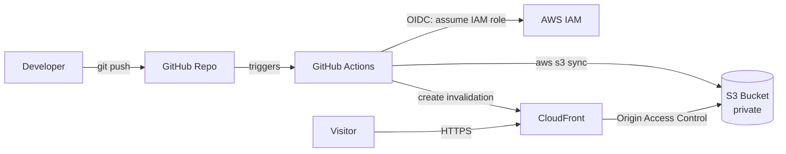

# Gym Site — Static Website on AWS with CI/CD

A static gym & fitness website hosted on **AWS S3 + CloudFront**, with automated deployments via **GitHub Actions** using **OIDC** (no stored AWS keys).

🔗 **Live site:** https://YOUR-DISTRIBUTION.cloudfront.net

---

## Architecture



**Flow:**
1. Code is pushed to the `main` branch.
2. GitHub Actions authenticates to AWS using OpenID Connect (short-lived credentials).
3. The workflow syncs site files to a private S3 bucket.
4. The workflow invalidates the CloudFront cache so changes go live immediately.
5. Visitors are served over HTTPS through CloudFront's global edge network.

---

## Tech Stack

| Layer | Tool |
|---|---|
| Frontend | HTML, CSS, JavaScript |
| Storage | Amazon S3 |
| CDN / HTTPS | Amazon CloudFront |
| Access control | CloudFront Origin Access Control (OAC) |
| CI/CD | GitHub Actions |
| Authentication | AWS IAM + GitHub OIDC |
| Version control | Git, GitHub |

---

## Security Decisions

- **Private S3 bucket** — "Block all public access" is enabled. The bucket is only readable by CloudFront via OAC, not directly from the internet.
- **No long-lived AWS keys** — GitHub Actions assumes an IAM role through OIDC. No access keys are stored in GitHub secrets.
- **Least-privilege IAM role** — the role can only write to this one bucket and invalidate this one distribution, and can only be assumed from this repo's `main` branch.
- **HTTPS enforced** — CloudFront redirects all HTTP traffic to HTTPS.

---

## Repository Structure

```
gym-site/
├── .github/
│   └── workflows/
│       └── deploy.yml      # CI/CD pipeline
├── css/
├── js/
├── images/
├── index.html
└── README.md
```

---

## Deployment

Deployments are fully automated. Any push to `main` triggers the pipeline:

```bash
git add .
git commit -m "Update homepage"
git push origin main
```

Pipeline steps (`.github/workflows/deploy.yml`):
1. Checkout code
2. Configure AWS credentials via OIDC
3. `aws s3 sync . s3://<bucket> --delete` (excluding repo files like `.git`, `README.md`)
4. `aws cloudfront create-invalidation --paths "/*"`

---

## Run Locally

```bash
git clone https://github.com/YOUR-USERNAME/gym-site.git
cd gym-site
# open index.html in a browser
```

---

## Cost

Runs within AWS Free Tier for low traffic. A billing budget alert is configured to catch unexpected charges.

---

## Future Improvements

- [ ] Infrastructure as Code with **Terraform** (S3, CloudFront, IAM, OIDC provider)
- [ ] Custom domain with **Route 53** + **ACM** SSL certificate
- [ ] HTML linting / link checking stage in the pipeline
- [ ] Separate staging and production environments

---

## Credits

Website template: **Neogym** by [Free-CSS.com](https://www.free-css.com/). The front-end design is not my own work — this project focuses on the cloud hosting, security, and CI/CD pipeline.
