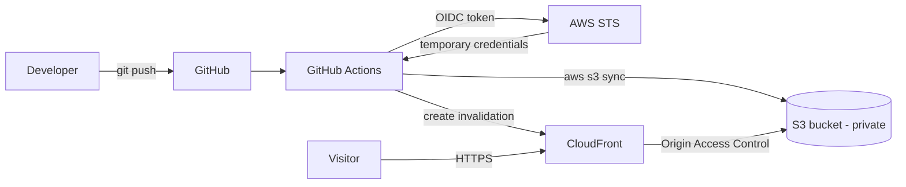

# Gym Site — Static Website on AWS with GitHub Actions CI/CD

A static gym website hosted on **Amazon S3 + CloudFront**, deployed automatically on every push to `main` by **GitHub Actions**. Authentication to AWS uses **GitHub OIDC** — no AWS access keys are stored anywhere.

🔗 **Live site:** https://d1iwv60x17x8ve.cloudfront.net


---

## Architecture



**How a deploy works**

1. A push to `main` that changes `site/` triggers the workflow.
2. GitHub issues a signed OIDC token; AWS STS verifies it against the IAM role's trust policy and returns credentials valid for one hour.
3. The workflow syncs `site/` to the private S3 bucket (`--delete` removes files deleted from the repo).
4. The CloudFront cache is invalidated so changes go live immediately.
5. A smoke test requests the live URL and fails the pipeline if it doesn't return HTTP 200.

---

## Tech Stack

| Area | Tools |
|---|---|
| Hosting | Amazon S3, Amazon CloudFront |
| CI/CD | GitHub Actions |
| Identity & access | AWS IAM, GitHub OIDC, CloudFront Origin Access Control |
| Frontend | HTML, CSS, JavaScript |

---

## Security Decisions

| Decision | Why |
|---|---|
| **Private S3 bucket** (Block Public Access on, ACLs disabled) | Files can't be fetched directly from S3, bypassing HTTPS and caching. |
| **Origin Access Control** with bucket policy scoped to one distribution ARN | Only this CloudFront distribution can read the bucket. |
| **GitHub OIDC instead of access keys** | No long-lived credentials to leak or rotate; each run gets credentials that expire in 1 hour. |
| **Trust policy pinned to the immutable repo subject** (`repo:owner@id/repo@id:ref:refs/heads/main`) | Only the `main` branch of this exact repository can deploy. A deleted and recreated repo with the same name gets new IDs and is rejected. |
| **Least-privilege IAM policy** | The role can only list/write this bucket and invalidate this distribution. |
| **HTTPS enforced** | CloudFront redirects HTTP to HTTPS. |
| **S3 versioning** | Previous file versions are kept for rollback after a bad deploy. |

---

## Repository Structure

```
gym-site/
├── .github/workflows/
│   └── deploy.yml              # CI/CD pipeline
├── docs/
│   ├── aws-setup.md            # S3, CloudFront, OIDC provider, IAM role
│   ├── github-setup.md         # repo, variables, workflow
│   └── troubleshooting.md      # problems hit during the build and how they were fixed
├── site/                       # website files (deployed to S3)
│   ├── index.html
│   ├── contact.html
│   ├── trainer.html
│   ├── why.html
│   └── css/  js/  images/
└── README.md
```

---

## Setup Guides

- **[AWS setup](docs/aws-setup.md)** — S3 bucket, CloudFront with OAC, GitHub OIDC provider, IAM deploy role
- **[GitHub setup](docs/github-setup.md)** — repository, Actions variables, deploy workflow
- **[Troubleshooting](docs/troubleshooting.md)** — real issues encountered and how they were diagnosed

---

## What I Learned

- Designing a static hosting setup where the storage layer is never publicly exposed.
- Replacing static cloud credentials with federated, short-lived identity (OIDC).
- Debugging IAM trust failures by inspecting the actual token claims instead of guessing.
- Testing infrastructure one layer at a time (S3 → CloudFront → IAM → pipeline) to isolate failures.

---

## Future Improvements

- [ ] Rebuild the infrastructure as code with **Terraform**
- [ ] Custom domain with **Route 53** + **ACM** certificate
- [ ] Security headers via a CloudFront response headers policy
- [ ] Separate staging environment for pull requests

---

## Credits

Website template: **Neogym** by [Free-CSS.com](https://www.free-css.com/). The front-end design is not my work — this project covers the AWS infrastructure, security and CI/CD pipeline.
